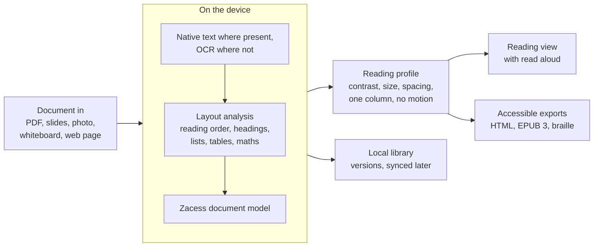

<picture>
  <source media="(prefers-color-scheme: dark)" srcset="https://raw.githubusercontent.com/zacesshq/.github/main/profile/assets/zacess-lockup-dark.svg">
  
</picture>

**Make every page accessible.** A free, open-source reader that turns study material into notes in your own reading profile.

[Website](https://zacess.com) · [Try it](https://app.zacess.com) · [Code themes](https://zacess.com/themes/) · [Discussions](https://github.com/zacesshq/.github/discussions) · [Code](https://github.com/zacesshq/zacess) · [Contributing](https://github.com/zacesshq/.github/blob/main/CONTRIBUTING.md)

## Why Zacess

Lecture slides, scanned handouts, textbook pages and whiteboards are often unreadable for people with low vision, blind people, people with dyslexia or visual stress and anyone who needs content laid out differently. Students today piece together four or five separate tools (a document reader, a magnifier, a lecture recorder, a literacy tool and a study app), many of them paid, desktop only or tied to dedicated hardware.

Zacess brings those jobs together in one free app. It takes inaccessible material, rebuilds it as a structured document, shows it in the reader's own profile, reads it aloud and keeps it as study material that works offline on every device.

## The name

Zacess (said like "success": za-SESS) brings two words together.

| Part | From | Meaning |
| --- | --- | --- |
| access | Latin *accessus*, from *ad* "to, toward" and *cēdō* "go, move" | Getting to the page |
| success | Latin *successus*, from *sub* "next to" and *cēdō* "go, move" | Getting through it |

*Access* and *success* share the same Latin root, *cēdō*, "to go". That is the idea behind Zacess: every reader should be able to reach a page and then get through it, in the way that works for them. **Make every page accessible.**

## How it works

Every file becomes one document model. Text is taken from the file where it has a text layer and recognised on the device where it does not, with any doubtful word, number or symbol flagged for checking. A reading profile is then applied as a view, so the original always stays exactly as imported. Nothing leaves the device unless the reader chooses a cloud feature.

## What it does

- **Import what you need to read.** PDFs and images, with OCR on the device for pages that have no text layer.
- **OCR you can check.** Low-confidence words, numbers and symbols are highlighted, with a stricter threshold for numbers, operators and units.
- **Reading profiles.** Presets for low vision, dyslexia, reduced visual clutter and screen readers, plus fine control of spacing, column width and contrast. Every contrast theme meets WCAG AAA. Settings never change silently.
- **Accessible exports.** Standalone HTML, EPUB 3 and braille-ready output, with equations kept as MathML.
- **A library you can trust.** Autosave, version history, a bin that keeps deleted items for 30 days and a full export in open formats.
- **Lecture capture.** Slide and whiteboard capture that skips repeats, recording, transcription on the device and one timeline for slides, audio, transcript and notes.
- **Study tools.** Flashcards scheduled with FSRS, reading goals with no streak pressure and export to Anki and Notion.
- **Bilingual reading.** The original beside its translation, keeping the reading position when switching.
- **Universal capture.** Web pages, shared text, images and files go straight into the library's inbox.

## Where it stands

> [!NOTE]
> Zacess is pre-release. An early browser version is open at [app.zacess.com](https://app.zacess.com): it opens PDFs, photos, Word files, web pages and text. It shows them in a reading profile, reads them aloud and exports HTML and EPUB 3, all in the browser with no upload and no account. The Rust core also holds the library, sync rules, lecture capture, study tools, bilingual reading and universal capture, which get their screens in later releases.

| Step | Status | What it covers |
| --- | --- | --- |
| Website | Live | [zacess.com](https://zacess.com) with what Zacess is, the roadmap and the accessibility statement |
| Code themes | Live | The four contrast themes for editors and terminals, see below |
| Browser version | Early version live | The core compiled to WebAssembly with pdf.js, Tesseract and mammoth, so everything runs on the device |
| Apps | Later | Tauri apps for Windows, macOS, Linux, iOS and Android around the same core |

Every phase is meant to be useful on its own. Each one is tested with people who have different access needs before it ships.

## Code themes

The reader's four contrast themes (Light, Dark, Yellow on Black and Cream) are also code themes, generated from one palette with every text and syntax colour at 7:1 or more and checked under three kinds of colour blindness. They are on the [VS Code Marketplace](https://marketplace.visualstudio.com/items?itemName=zacess.zacess-themes), [Open VSX](https://open-vsx.org/extension/zacess/zacess-themes) and the [Obsidian community directory](https://community.obsidian.md/themes/zacess). Neovim installs them from [zacess.nvim](https://github.com/zacesshq/zacess.nvim). JetBrains IDEs, Zed, Sublime Text, Helix, Emacs and five terminals are covered in [themes](https://github.com/zacesshq/themes). Try each one on 20 languages on the [code themes page](https://zacess.com/themes/).

## Built with

### Languages

|  |  |  |
| :---: | :---: | :---: |
| **Rust** | **TypeScript** | **Python** |

### Core and apps

|  |  |  |
| :---: | :---: | :---: |
| **WebAssembly** | **Tauri** | **SQLite** |

### Infrastructure

|  |  |  |
| :---: | :---: | :---: |
| **Cloudflare** | **PostgreSQL** | **Crowdin** |

| Layer | Stack |
| --- | --- |
| Core engine | Rust, compiled to WebAssembly for browsers and to native code for every operating system |
| Apps | Tauri 2 for Windows, macOS, Linux, iOS and Android |
| Interface | TypeScript and React with Radix, rendered as real HTML so screen readers and braille displays work with it |
| Library | SQLite on the device |
| Sync | Local-first CRDT sync (Automerge or Yjs) |
| Voices | System voices and Piper, both on the device |
| Server (later) | Rust (Axum) with PostgreSQL |
| Heavy processing (paid tier, later) | Python workers |
| Hosting | Cloudflare Workers static assets, with R2 later |
| Translations | Crowdin for the interface |

## Repositories

| Repository | What it is |
| --- | --- |
| [zacess](https://github.com/zacesshq/zacess) | The code under AGPL-3.0: the Rust core, the quality suite and the browser app. All development happens here |
| [website](https://github.com/zacesshq/website) | The site at [zacess.com](https://zacess.com) |
| [themes](https://github.com/zacesshq/themes) | The four contrast themes as code themes for editors and terminals, under MIT |
| [core](https://github.com/zacesshq/core), [quality](https://github.com/zacesshq/quality) and [app](https://github.com/zacesshq/app) | Read-only copies of each part, published from `zacess` |
| [obsidian-theme](https://github.com/zacesshq/obsidian-theme) and [zacess.nvim](https://github.com/zacesshq/zacess.nvim) | Read-only copies of the Obsidian theme and the Neovim schemes, published from `themes` |

Issues and pull requests go to `zacess` or `themes` and questions to this organisation's Discussions, never to the copies.

## Get involved

- **Follow along and ask questions:** [Discussions](https://github.com/zacesshq/.github/discussions), with [Announcements](https://github.com/zacesshq/.github/discussions/categories/announcements) for news, [Ideas](https://github.com/zacesshq/.github/discussions/categories/ideas) for suggestions and [Q&A](https://github.com/zacesshq/.github/discussions/categories/q-a) for help
- **Report a problem or suggest a change:** [open an issue on `zacess`](https://github.com/zacesshq/zacess/issues/new/choose). For the code themes use [`themes`](https://github.com/zacesshq/themes/issues/new/choose)
- **Contributing:** the [contributing guide](https://github.com/zacesshq/.github/blob/main/CONTRIBUTING.md)
- **Accessibility:** the [accessibility statement](https://github.com/zacesshq/.github/blob/main/ACCESSIBILITY.md). An accessibility problem is a bug
- **Security:** report vulnerabilities privately through the [security policy](https://github.com/zacesshq/.github/blob/main/SECURITY.md)
- **Contact:** [contact@zacess.com](mailto:contact@zacess.com)

## Licence

The code is licensed under AGPL-3.0. Anyone who runs a modified version as a service must publish their changes, so the core stays free and open for everyone. The code themes are under MIT so they can be used anywhere.
